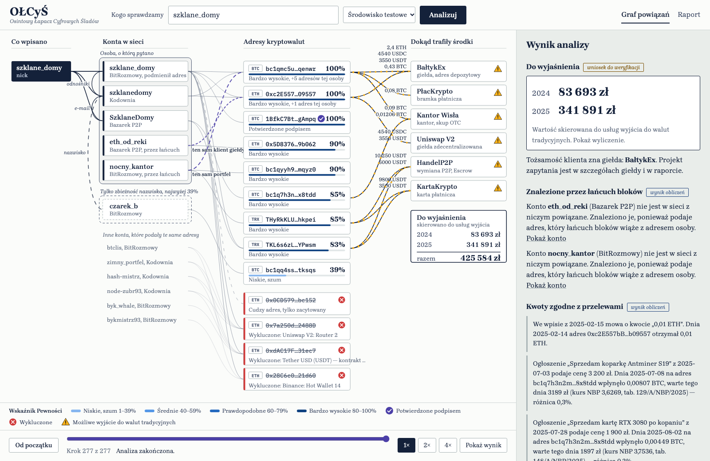
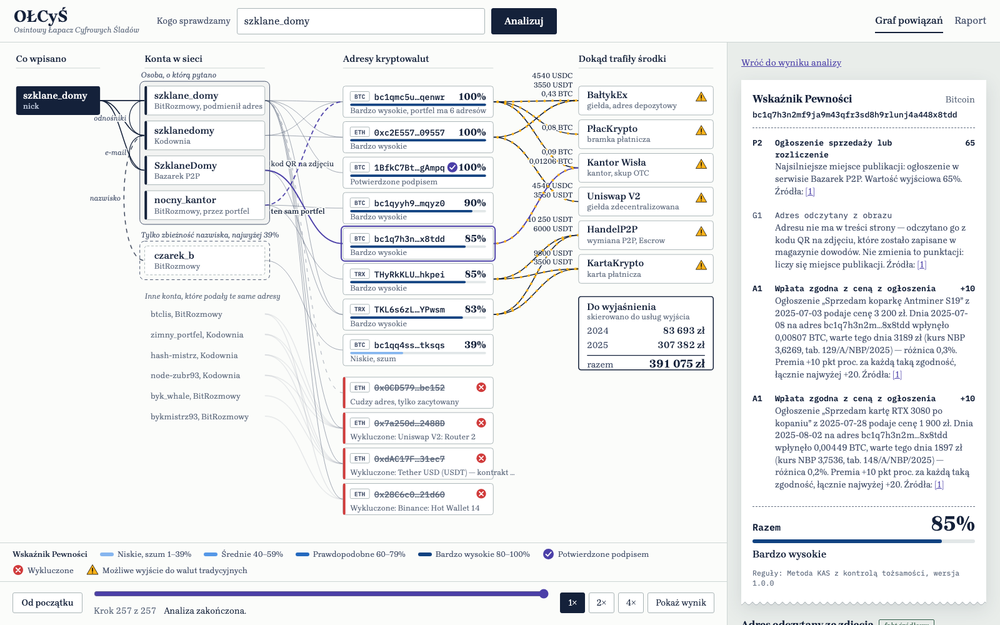
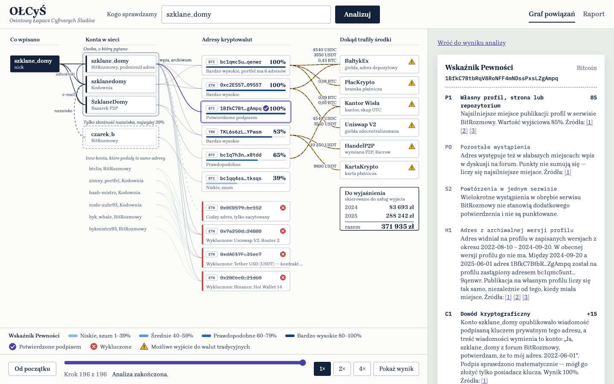
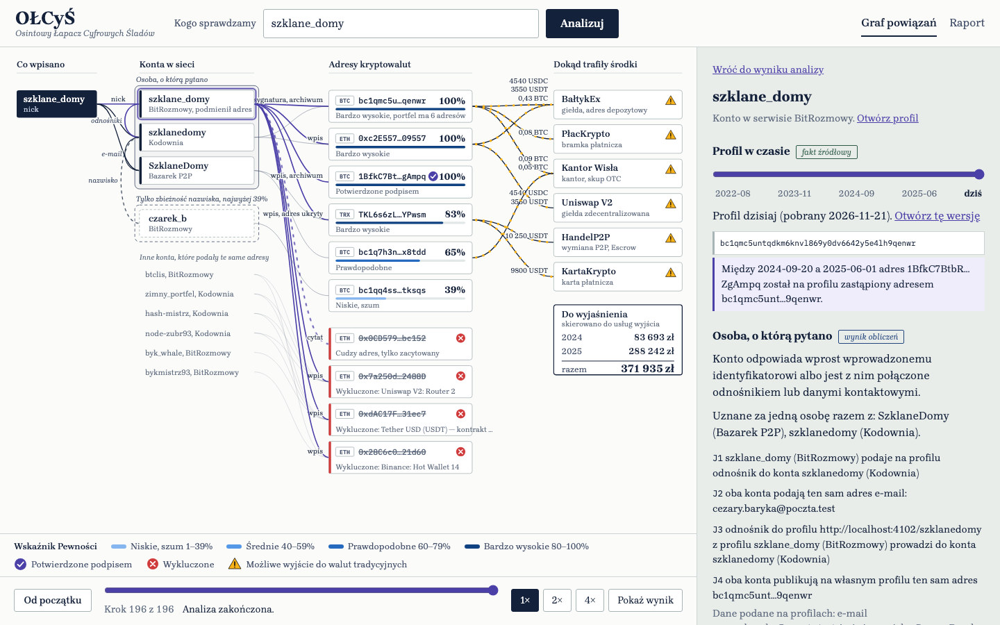
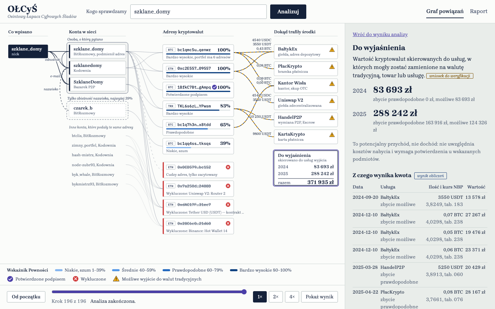

# OŁCyŚ — Osintowy Łapacz Cyfrowych Śladów

Narzędzie OSINT dla analityków KAS. Po podaniu jednego identyfikatora (nick, imię i nazwisko, e-mail, telefon, adres krypto) samo przeszukuje publiczne źródła, znajduje powiązane adresy kryptowalutowe i zapisuje każdy ślad razem ze źródłem.

> Stan: **etap 5 z 7 oraz pogłębione wyszukiwanie i źródła rzeczywiste**. Narzędzie pracuje w rundach między siecią a łańcuchem bloków, dopasowuje kwoty do przelewów, czyta nazwy adresów (ENS) i rozpoznaje tego samego klienta giełdy. Obok środowiska testowego ma konektory do źródeł rzeczywistych: GitHub, eksplorator Bitcoin, węzeł Ethereum z ENS, NBP, Wayback Machine.



| Adres odczytany z kodu QR na zdjęciu | Dowód z podpisanej wiadomości |
|---|---|
|  |  |

| Podmiana adresu na profilu w czasie | Szacunek i jego wyliczenie |
|---|---|
|  |  |

Przykładowy raport: [`docs/przykladowy-raport.pdf`](docs/przykladowy-raport.pdf).

## Założenia

- **Tylko dane publiczne.** Silnik łączy się wyłącznie z hostami z listy dozwolonych; każda próba połączenia jest zapisywana.
- **Wszystko da się odtworzyć.** Każda pobrana strona trafia do magazynu dowodów z adresem URL, datą pobrania i skrótem SHA-256, a kolejne wpisy są połączone łańcuchem skrótów — zmiana dowolnego rekordu jest wykrywalna.
- **Brak chmury publicznej.** Całość działa lokalnie; baza to PostgreSQL.
- **Rozszerzalność.** Nowe źródło to jedna implementacja interfejsu `SourceConnector`, nowa sieć blockchain to jeden `AddressCodec`.
- **Dane testowe są syntetyczne.** Wbudowane środowisko to trzy fikcyjne serwisy (forum, repozytoria kodu, ogłoszenia P2P) i eksplorator łańcucha bloków z fikcyjnymi osobami i znaną „prawdą” do sprawdzania wyników.

## Uruchomienie

Wymagany Node.js 20.19 lub nowszy.

```bash
npm install
npm test                          # 104 testy, w tym scenariusze akceptacyjne na wszystkich osobach syntetycznych
npm run world                     # terminal 1: środowisko syntetyczne (porty 4101–4106)
npm run analyze -- szklane_domy   # terminal 2: analiza od jednego nicku, wynik w konsoli
npm run api                       # terminal 2: API HTTP na porcie 4000
npm run web                       # terminal 3: interfejs na http://localhost:5173
npm run check:ui                  # opcjonalnie: przejście całego scenariusza w przeglądarce bez okna
npx tsx scripts/live-smoke.ts     # opcjonalnie: sprawdzenie konektorów na żywych usługach
```

Domyślnie baza działa jako wbudowany PostgreSQL w katalogu `.data/` (bez instalowania serwera). Dla zwykłego serwera PostgreSQL ustaw `DATABASE_URL=postgres://…` (zob. `.env.example`) albo użyj `docker compose up`.

Inne dane wejściowe: `--name "Cezary Baryka"`, `--email …`, `--phone …`, `--address …`, `--url …`; parametry: `--depth n`, `--json`, `--verbose`.

## Interfejs

Jeden ekran, jedna historia. Po wpisaniu identyfikatora graf rośnie krok po kroku w czterech kolumnach: co wpisano, konta w sieci, adresy kryptowalut, dokąd trafiły środki. Każdy krok analizy jest zapisywany, więc dowolną wcześniejszą analizę można odtworzyć, zatrzymać i przewinąć (`?run=<identyfikator analizy>`).

- **Paragon.** Kliknięcie adresu pokazuje Wskaźnik Pewności jak paragon: każda reguła to pozycja z punktami i źródłami, na dole suma.
- **Odrzucenia.** Adres giełdy, kontraktu lub cudzy adres z cytatu zostaje w grafie przekreślony, z powodem.
- **Trzy rodzaje stwierdzeń.** Każdy blok jest oznaczony jako fakt źródłowy, wynik obliczeń albo wniosek do weryfikacji.
- **Raport.** Druga zakładka pokazuje gotowy raport z przyciskiem pobrania PDF.
- Czcionki są dołączone do aplikacji; interfejs nie pobiera niczego z zewnętrznych serwerów.

## Co robi analiza

1. **Szuka śladów.** Sprawdza identyfikator we wszystkich źródłach i idzie za tropami z własnych treści osoby (linki do profili, e-mail, telefon, imię i nazwisko).
2. **Wykrywa adresy.** Bitcoin, Ethereum i Tron; każdy kandydat musi przejść sumę kontrolną. Rozpoznaje też adresy ukryte: znakami niewidocznymi, literami z innego alfabetu, pocięte na fragmenty, obecne tylko w adresie linku.
3. **Ustala tożsamość.** Konta łączy w jedną osobę wyłącznie na twardych przesłankach (odnośnik między profilami, ten sam e-mail lub telefon, ten sam adres na własnych profilach, ten sam wprowadzony nick). Samo imię i nazwisko nigdy nie łączy kont.
4. **Liczy Wskaźnik Pewności.** Reguły są danymi (`packages/scoring/src/ruleset.ts`) i są zapisywane z każdym wynikiem, więc wynik da się odtworzyć i przeliczyć po zmianie reguł.
5. **Odrzuca błędne przypisania.** Etykiety podmiotów (lista wbudowana i etykiety eksploratora), kod kontraktu, adresy publikowane przez wiele obcych kont, cytaty.
6. **Analizuje łańcuch bloków.** Wolumen, okres aktywności i wzorce możliwego wyjścia do walut tradycyjnych.

### Źródła rzeczywiste

W interfejsie obok pola wyszukiwania wybiera się źródła: „Środowisko testowe” albo „Internet, na żywo”. Oba zestawy korzystają z tych samych interfejsów, więc cała analiza działa identycznie.

| Źródło | Co daje | Uwagi |
|---|---|---|
| GitHub (API) | profil, README profilu, README i plik FUNDING własnych repozytoriów; z tokenem także wyszukiwanie adresu w kodzie | bez tokenu 60 zapytań na godzinę na adres IP — ustaw `GITHUB_TOKEN` |
| Eksplorator Bitcoin (format Esplora) | saldo, historia, adresy finansujące tę samą transakcję (rozszerzenie portfela) | `BITCOIN_API_URL`; może wskazywać własny eksplorator |
| Węzeł Ethereum (JSON-RPC) | czy adres ma kod (kontrakt, delegacja, zwykłe konto), liczba transakcji, saldo | `ETH_RPC_URL`; historia przelewów wymaga indeksera |
| ENS | adres dla nazwy, nazwa zgłoszona przez adres, rekordy właściciela | przez ten sam węzeł |
| NBP | kursy średnie, tabela A | `api.nbp.pl` |
| Wayback Machine | dawne wersje profili | `web.archive.org` |
| Coinbase Exchange | dzienne kursy BTC i ETH | publiczne dane rynkowe |

Każdy zestaw ma własną listę dozwolonych hostów; żądanie do innego hosta jest odrzucane i zapisywane. Token dostępu jest wysyłany w nagłówku i nigdy nie trafia do magazynu dowodów.

### Z łańcucha bloków z powrotem do sieci

Zwykłe przeszukiwanie profili znajduje tylko to, co ktoś sam ze sobą połączył. Narzędzie idzie dalej, w rundach:

1. Z opublikowanego adresu odtwarza cały portfel (reguła W1).
2. Każdy ukryty adres portfela wyszukuje w sieci. Adres jest unikalnym ciągiem znaków, więc wyszukiwanie dokładne nie daje przypadkowych trafień.
3. Konto, które podało taki adres, należy do tej samej osoby — łączy je łańcuch bloków, nie sieć (reguła J6). Konto jest wtedy czytane w całości: profil, wpisy, archiwum.
4. Nowe adresy z tego konta trafiają do analizy łańcucha i pętla się powtarza, aż nie pojawia się nic nowego.

Adres z tego samego portfela co adres o wyższym wyniku dostaje jego wynik, najwyżej 90% (reguła W2).

**Ten sam klient giełdy (D2).** Giełda przydziela adres depozytowy jednemu klientowi. Jeśli na adres depozytowy, na który wpłacała osoba, wpłacał też inny adres (nie więcej niż trzy), należy on do tej samej osoby i jest dalej traktowany jak adres jej portfela — także wyszukiwany w sieci.

**Nazwy adresów (E1, N1, J7).** Nazwa podana w treści („szklanedomy.eth”) jest zamieniana na adres. Dla każdego adresu osoby sprawdzana jest nazwa, którą sam zgłosił, oraz rekordy ustawione przez jej właściciela. Rekordy są nowymi tropami; jeśli wskazują konto, które samo podaje ten adres, powiązanie jest potwierdzone z obu stron i wynik wynosi co najmniej 95%.

**Kwoty zgodne z przelewami (A1).** Cena z ogłoszenia („3 200 zł”) jest porównywana z wpłatami na adresy osoby w ciągu 45 dni od publikacji, przeliczonymi na złote według kursu z dnia i tabeli NBP. Kwota kryptowaluty podana we wpisie („0,01 ETH doszło”) jest porównywana z przelewami tego aktywa w ciągu 4 dni. Zgodność jednoznaczna daje +10 pkt proc., łącznie najwyżej +20; gdy pasuje więcej niż jeden przelew, zgodność jest tylko odnotowana. W ten sposób z adresem wiąże się także ogłoszenie, w którym adresu w ogóle nie ma.

### Ślady, których nie widać w tekście

- **Kod QR na zdjęciu (G1).** Zdjęcia z ogłoszeń są pobierane, zapisywane w magazynie dowodów i odczytywane lokalnie. Adres z kodu QR jest przypisywany do ogłoszenia tak samo jak adres z tekstu; interfejs pokazuje zdjęcie, z którego go odczytano.
- **Podpisana wiadomość (C1, C2, C0).** Wiadomość podpisana kluczem adresu (Bitcoin, Ethereum) jest sprawdzana matematycznie. Jeśli wymienia konto, które ją opublikowało, wynik wynosi 100% i adres dostaje oznaczenie „potwierdzone podpisem”. Podpis prawidłowy, ale bez wskazania konta, daje +30 pkt proc. (najwyżej 95%). Podpis nieprawidłowy nie zmienia wyniku i jest odnotowany.
- **Archiwum stron (H1).** Dla profili osoby pobierane są wersje zapisane w archiwum. Adres, który był na profilu wcześniej, jest przypisywany jak adres z własnego profilu, a zamiana jednego adresu na inny jest zgłaszana wprost („między … a … adres A został zastąpiony adresem B”). W szczegółach konta jest suwak z kolejnymi wersjami profilu.
- **Inny zapis nicku.** Sprawdzane są też warianty nicku różniące się separatorami (`szklane_domy` → `szklanedomy`). Konto znalezione tylko w ten sposób, bez innego powiązania, ma wynik ograniczony do 79%.
- **Co może podważyć wynik.** Przy każdym adresie narzędzie samo wypisuje najmocniejsze zastrzeżenia (np. „adres tylko w jednym serwisie”, „zdjęcie mogło zostać skopiowane”) i wskazuje, co by je rozstrzygnęło.

### Wskaźnik Pewności

| Reguła | Przesłanka | Wartość |
|---|---|---|
| P1 | Adres na własnym profilu, stronie lub w repozytorium | 85% |
| P2 | Adres w ogłoszeniu sprzedaży lub rozliczeniu | 65% |
| P3 | Adres we wpisie w dyskusji na forum | 45% |
| P4 | Adres w masowych komentarzach (konkurs, rozdawnictwo) | 20% |
| S1 | Ten sam adres w co najmniej 2 niezależnych serwisach | +15 pkt proc. |
| O1 | Adres celowo ukryty przed automatami | +3 pkt proc. |
| W2 | Adres z tego samego portfela co adres o wyższym wyniku | wynik tamtego adresu, najwyżej 90% |
| A1 | Wpłata zgodna z publicznie podaną kwotą | +10 pkt proc. za każdą, najwyżej +20 |
| N1 | Nazwa adresu wskazuje konto, które podaje ten adres | co najmniej 95% |
| C1 | Podpisana wiadomość wymieniająca konto | 100% |
| C2 | Podpisana wiadomość bez wskazania konta | +30 pkt proc., najwyżej 95% |
| T1 | Limit pewności tożsamości: podobny nick albo tylko nazwisko | najwyżej 79%, 59% lub 39% |
| X1 | Adres oznaczonego podmiotu (giełda, token, mikser, zbiórka…) | 0% |
| X2 | Smart kontrakt (kod wykonywalny) | 0% |
| X3 | Adres publikowany przez 3 lub więcej niepowiązanych kont | 0% |
| Q1 | Adres tylko zacytowany z cudzej wypowiedzi | nie do przypisania |

Liczy się najsilniejsze miejsce publikacji; powtórzenia w jednym serwisie nie są punktowane. Konto prywatne z delegacją EIP-7702 i portfel kontraktowy (np. Safe) nie są wykluczane, mimo że mają kod.

Pasma: 80–100% bardzo wysokie, 60–79% prawdopodobne, 40–59% średnie, 1–39% niskie / szum, 0% wykluczone.

### Portfel, giełda i szacunek w złotych

- **Portfel (reguła W1).** Adresy, z których środki wydano w jednej transakcji, kontroluje ta sama osoba. Z jednego opublikowanego adresu narzędzie odtwarza cały portfel; adresy oznaczonych usług nigdy do niego nie wchodzą.
- **Giełda (reguły L1 i D1).** Adres depozytowy giełdy rozpoznawany jest po etykiecie albo po przepływie: nieoznaczony adres, który co najmniej 90% otrzymanych środków przekazał na portfel giełdy, jest jej adresem depozytowym dla jednego klienta. Giełda zna tożsamość tego klienta, więc narzędzie przygotowuje projekt zapytania z wykazem wpłat.
- **Szacunek.** Wartość przelewu = ilość × dzienny kurs rynkowy w USD × kurs średni USD/PLN z tabeli A NBP z ostatniego dnia roboczego przed dniem przelewu. Sumy podawane są według lat podatkowych, z podziałem na zbycie prawdopodobne (kantor, bramka, karta, P2P) i możliwe (giełda). Wymiana między kryptowalutami nie jest liczona. Do szacunku wchodzą tylko adresy z wynikiem co najmniej 60% na kontach pewnie powiązanych z osobą.
- Szacunek to potencjalny przychód do wyjaśnienia, a nie dochód — jest wnioskiem do weryfikacji.

Kursy NBP pobierane są z publicznego API banku (`NBP_API_URL=https://api.nbp.pl`); domyślnie używana jest dołączona kopia rzeczywistych tabel, żeby narzędzie działało bez Internetu.

### Raport

`GET /api/runs/<id>/report` zwraca raport jako jeden samodzielny dokument HTML, a `/report.pdf` — jako PDF. Raport zawiera: podsumowanie, konta osoby, adresy z uzasadnieniem i źródłami, odrzucone przypisania, aktywność w łańcuchu bloków, szacunek z każdą użytą tabelą NBP, chronologiczny przebieg przepływu środków, projekt zapytania do giełdy, pełny wykaz zapisanych dowodów ze skrótami SHA-256 i słowniczek. Każda część jest oznaczona jako fakt źródłowy, wynik obliczeń albo wniosek do weryfikacji.

### Wskaźniki wyjścia do walut tradycyjnych

Przelewy wychodzące na adresy giełd (W1), usług P2P (W2), bramek płatniczych (W3), kart krypto-fiat (W4), kantorów (W5) oraz wymiana znacznej wartości na stablecoiny (W6). Są to wnioski do weryfikacji, a nie ustalenia.

Przykład wyniku (`npm run analyze -- szklane_domy`, skrót):

```
━━ T1  entered  (identity cap 100%)  SzklaneDomy@bazarek, szklane_domy@bitrozmowy, szklanedomy@kodownia
     J1  szklane_domy (bitrozmowy) podaje na profilu odnośnik do konta szklanedomy (kodownia)
     J2  oba konta podają ten sam adres e-mail: cezary.baryka@poczta.test

   83%  BARDZO WYSOKIE     TRON TKL6s6zLGRwofb5ejkLAY7oQ4ofE5YPwsm
        P2   65 →  65  Ogłoszenie sprzedaży lub rozliczenie: Najsilniejsze miejsce publikacji: ogłoszenie w serwisie bazarek.
        S1  +15 →  80  Synergia śladów: Ten sam adres w 2 niezależnych źródłach (bazarek, bitrozmowy).
        O1   +3 →  83  Adres celowo ukryty przed automatami: Autor zamaskował adres (split).
        W2  CASH-OUT?  Usługa wymiany P2P: 2 przelewy do usługi P2P (HandelP2P: Escrow), łącznie 10 250 USDT.

    0%  WYKLUCZONE         ETHEREUM 0x28C6c06298d514Db089934071355E5743bf21d60
        X1    0 →   0  Adres oznaczonego podmiotu: „Binance: Hot Wallet 14” (kategoria: exchange).

━━ T2  name_ambiguous  (identity cap 39%)  czarek_b@bitrozmowy
   39%  NISKIE / SZUM      BITCOIN bc1qq4ssxcx5plwaeh9jupqf002n2lzw0zqkntksqs
        T1   39 →  39  Limit pewności tożsamości: to samo imię i nazwisko mają 2 niepowiązane ze sobą grupy kont.

Evidence chain: intact (83 snapshots verified).
```

## Struktura repozytorium

| Katalog | Zawartość |
|---|---|
| `packages/core` | Typy domenowe, walidacja i wykrywanie adresów, interfejs konektora |
| `packages/db` | Schemat PostgreSQL (migracje SQL) i warstwa zapisu |
| `packages/connectors` | Konektory źródeł i eksploratora (na razie środowisko testowe) |
| `packages/scoring` | Reguły punktacji, ustalanie tożsamości, Wskaźnik Pewności, wskaźniki blockchain, szacunek w złotych |
| `packages/report` | Raport HTML/PDF |
| `packages/vision` | Odczyt kodów QR ze zdjęć |
| `packages/engine` | Przebieg analizy, kontrola ruchu wychodzącego, magazyn dowodów |
| `packages/world` | Generator i serwer środowiska syntetycznego |
| `apps/api` | API HTTP (Fastify) i wiersz poleceń |
| `apps/web` | Interfejs (React) |

## Licencje wykorzystanych komponentów

| Komponent | Licencja |
|---|---|
| @noble/hashes, @noble/curves, @scure/base | MIT |
| cheerio, fastify, zod, pg, tsx, vitest | MIT |
| React, Vite, @vitejs/plugin-react | MIT |
| Brygada 1918, IBM Plex Mono (czcionki, przez @fontsource) | OFL-1.1 |
| Playwright (wydruk raportu do PDF, testy interfejsu) | Apache-2.0 |
| jsQR | Apache-2.0 |
| pngjs, qrcode | MIT |
| jpeg-js | BSD-3-Clause |

Dane referencyjne dołączone do środowiska testowego: kursy średnie NBP (tabela A, api.nbp.pl) oraz dzienne kursy zamknięcia BTC i ETH (publiczne dane rynkowe Coinbase Exchange). Odświeżenie: `node scripts/fetch-reference-data.mjs`.
| @electric-sql/pglite, TypeScript | Apache-2.0 |
| PostgreSQL | PostgreSQL License |
