# OŁCyŚ — Osintowy Łapacz Cyfrowych Śladów

Narzędzie OSINT dla analityków KAS. Po podaniu jednego identyfikatora (nick, imię i nazwisko, e-mail, telefon, adres krypto) samo przeszukuje publiczne źródła, znajduje powiązane adresy kryptowalutowe i zapisuje każdy ślad razem ze źródłem.

> Stan: **etap 5 z 7, pogłębione wyszukiwanie, źródła rzeczywiste, analizy cykliczne, czytanie wpisów**. Narzędzie pracuje w rundach między siecią a łańcuchem bloków. W trybie na żywo korzysta z kont, które same podpisują swoje adresy (Farcaster, Keybase), i sprawdza te podpisy matematycznie. Wpisy osoby czyta lokalny klasyfikator, a wybrane — model językowy Bielik uruchomiony na tej samej maszynie; ten sam model na żądanie opisuje sprawę. Sprawę można analizować ponownie według harmonogramu; każda kolejna analiza mówi, co się zmieniło.

Zakończona analiza otwiera się na podsumowaniu; dalej sprawa jest czytana w kolejności, w jakiej prowadzi się analizę — sześć kroków, od wprowadzonych danych do źródeł i raportu.

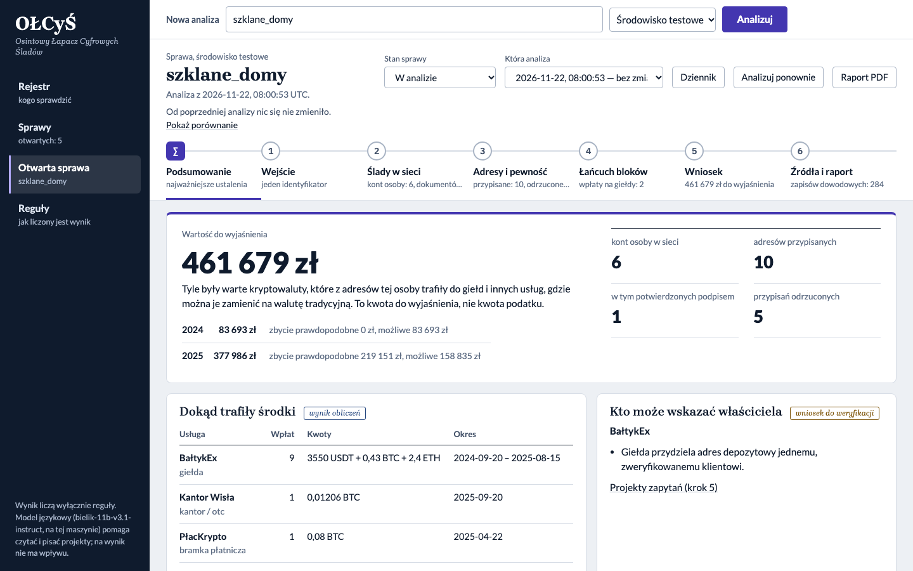

| Krok 2. Ślady w sieci: przebieg poszukiwań, który można odtworzyć | Krok 3. Adresy i pewność: jedna tabela, obok wyliczenie wyniku |
|---|---|
| 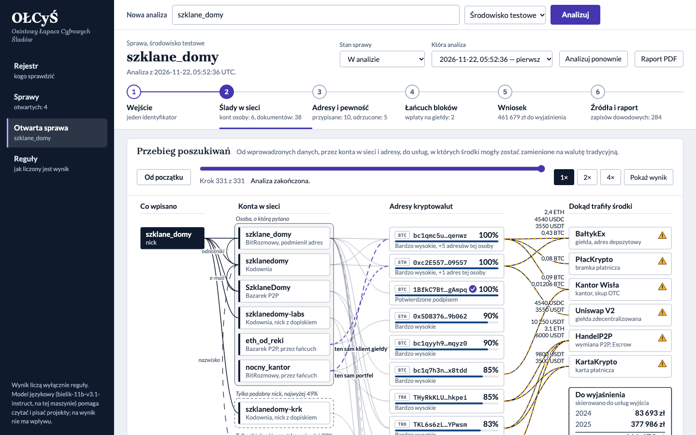 | 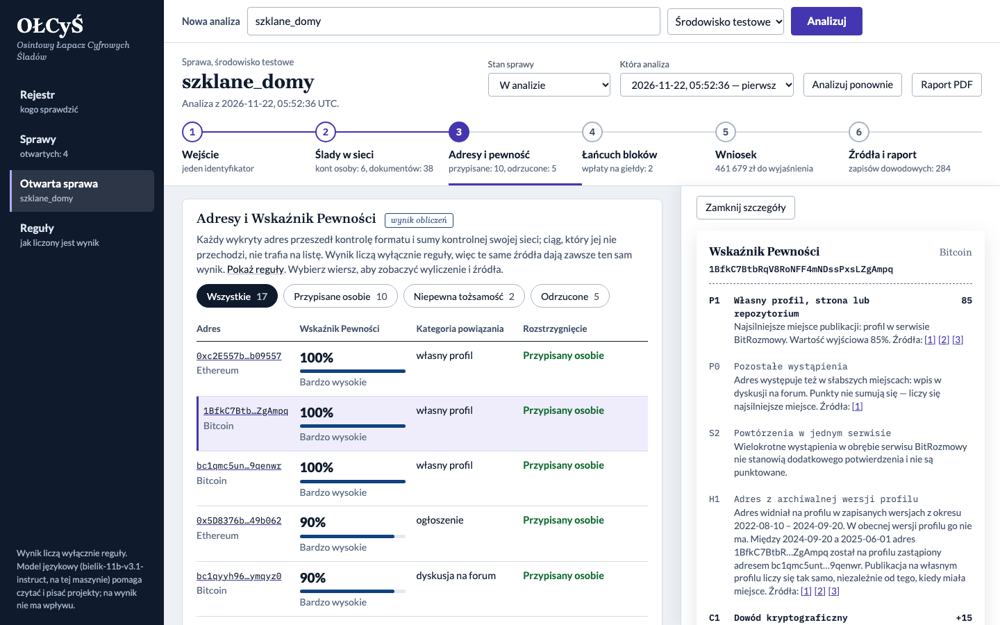 |

| Krok 3. Odrzucone przypisanie z powodem | Krok 4. Łańcuch bloków: wolumen, wzorce, giełdy |
|---|---|
| 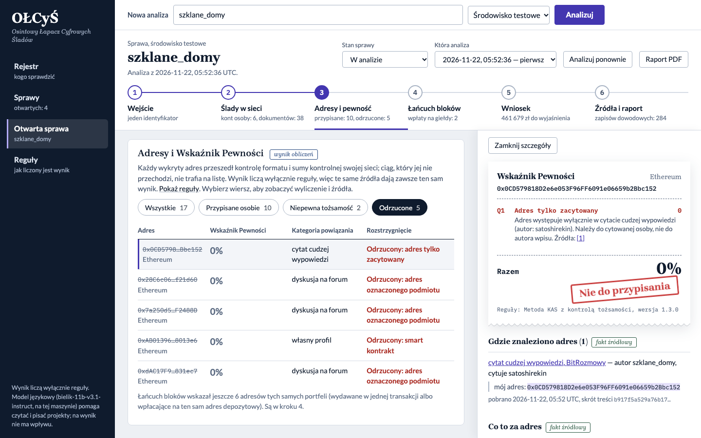 | 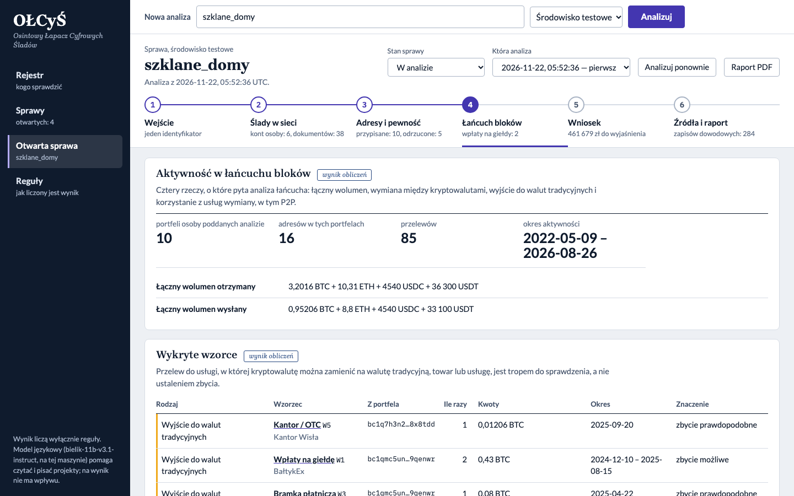 |

| Krok 5. Wniosek: wartość do wyjaśnienia i jej wyliczenie | Krok 5. Opis sprawy pisany przez model: każde zdanie wskazuje ustalenia |
|---|---|
| 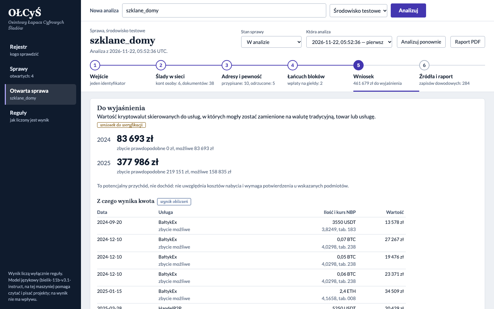 | 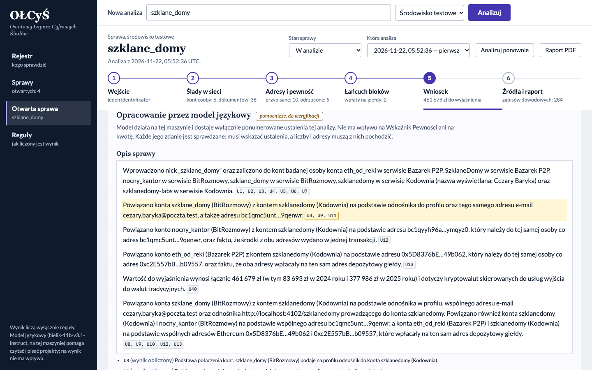 |

| Krok 1. Wejście: co wprowadzono, parametry wyszukiwania, źródła | Krok 6. Źródła i raport: magazyn dowodów |
|---|---|
| 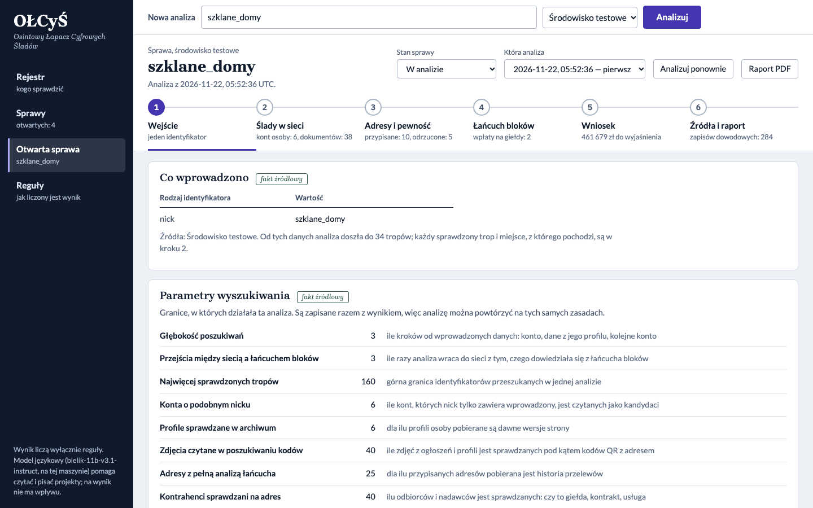 | 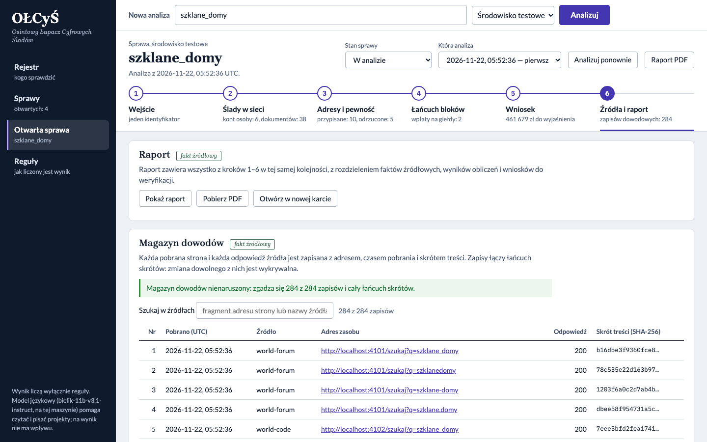 |

| Sprawy: stan każdej sprawy i wynik ostatniej analizy | Reguły: cały algorytm Wskaźnika Pewności na jednej stronie |
|---|---|
| 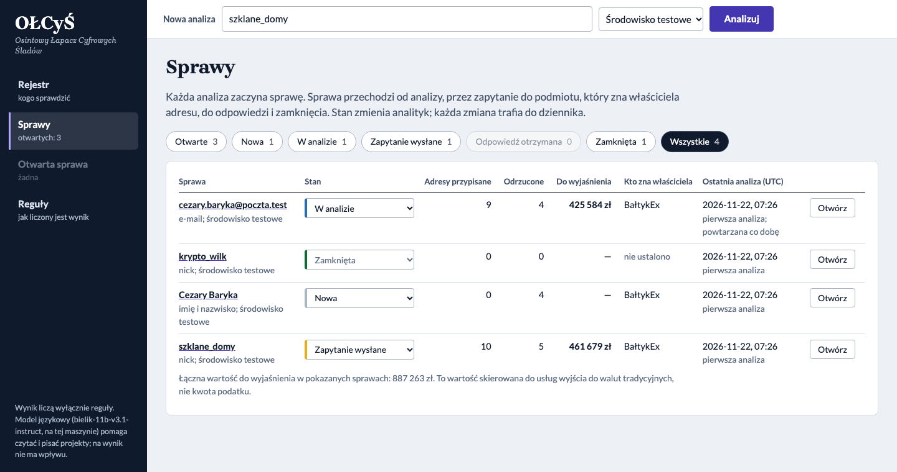 | 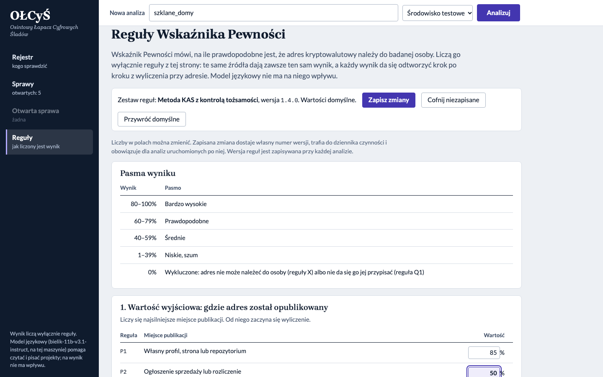 |

| Rejestr polskich portfeli: pod listą portfeli liczby zbiorcze |
|---|
| 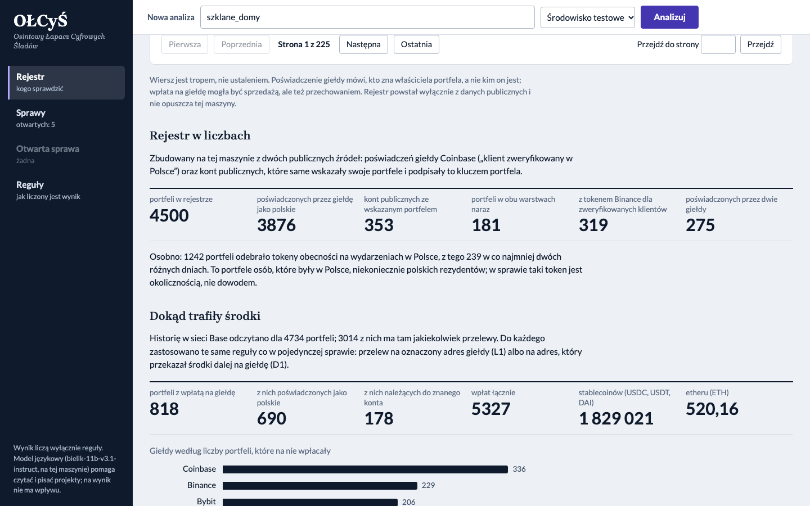 |

Przykładowy raport: [`docs/przykladowy-raport.pdf`](docs/przykladowy-raport.pdf).

## Założenia

- **Tylko dane publiczne.** Silnik łączy się wyłącznie z hostami z listy dozwolonych; każda próba połączenia jest zapisywana.
- **Wszystko da się odtworzyć.** Każda pobrana strona trafia do magazynu dowodów z adresem URL, datą pobrania i skrótem SHA-256, a kolejne wpisy są połączone łańcuchem skrótów — zmiana dowolnego rekordu jest wykrywalna.
- **Wynik mówi, czego w nim brakuje.** Źródło, które nie odpowiedziało, odmówiło albo zwróciło błąd, nie przerywa analizy, ale zostaje zapisane; panel wyniku i raport mają sekcję „Czego nie udało się odczytać”. Zapytania, od których zależy kwota (kursy NBP, kursy rynkowe, etykiety giełd, historia sieci Base), są ponawiane, zanim brak zostanie odnotowany.
- **Brak chmury publicznej.** Całość działa lokalnie; baza to PostgreSQL.
- **Rozszerzalność.** Nowe źródło to jedna implementacja interfejsu `SourceConnector`, nowa sieć blockchain to jeden `AddressCodec`.
- **Dane testowe są syntetyczne.** Wbudowane środowisko to trzy fikcyjne serwisy (forum, repozytoria kodu, ogłoszenia P2P) i eksplorator łańcucha bloków z fikcyjnymi osobami i znaną „prawdą” do sprawdzania wyników.

## Uruchomienie

Wersja pokazowa: **https://olcys.maciejkopiec.com** — rejestr 4 500 portfeli, sprawa testowa `szklane_domy` i dwie sprawy na danych publicznych (`kedrix`, `jaroslawbolek`); opis sprawy pisze Claude Opus 5.5.

Wymagany Node.js 20.19 lub nowszy.

```bash
npm install
npm test                          # 220 testów, w tym scenariusze akceptacyjne na wszystkich osobach syntetycznych
npm run world                     # terminal 1: środowisko syntetyczne (porty 4101–4106)
npm run analyze -- szklane_domy   # terminal 2: analiza od jednego nicku, wynik w konsoli
npm run api                       # terminal 2: API HTTP na porcie 4000
npm run web                       # terminal 3: interfejs na http://localhost:5173
npm run check:ui                  # opcjonalnie: przejście całego scenariusza w przeglądarce bez okna
npx tsx scripts/live-smoke.ts     # opcjonalnie: sprawdzenie konektorów na żywych usługach
```

Domyślnie baza działa jako wbudowany PostgreSQL w katalogu `.data/` (bez instalowania serwera). Dla zwykłego serwera PostgreSQL ustaw `DATABASE_URL=postgres://…` (zob. `.env.example`) albo użyj `docker compose up`.

Inne dane wejściowe: `--name "Cezary Baryka"`, `--email …`, `--phone …`, `--address …`, `--url …`; parametry: `--depth n`, `--json`, `--verbose`.

## Interfejs

Interfejs ma trzy miejsca pracy i stronę z regułami.

- **Rejestr** — kogo sprawdzić. Najpierw lista: każdy portfel rejestru (4 500), po 20 na stronie, z przechodzeniem między stronami i do wybranej strony; na górze portfele, które wysłały najwięcej na giełdy, dalej te, o których wiadomo najwięcej. Filtr zawęża listę (z wpłatą na giełdę, ze znanym kontem, poświadczone, z tokenem Binance). Dane osobowe są zakryte do chwili kliknięcia „Odkryj dane”. „Analizuj” przy wierszu zakłada sprawę dla tego portfela. Pod listą są liczby zbiorcze.
- **Sprawy** — biurko analityka: każda sprawa ze stanem (nowa, w analizie, zapytanie wysłane, odpowiedź otrzymana, zamknięta), liczbą adresów przypisanych i odrzuconych, wartością do wyjaśnienia, podmiotami, które znają właściciela, i informacją, czy ostatnia analiza wykazała zmiany. Zmiana stanu trafia do dziennika czynności.
- **Sprawa** — jedna sprawa. Zakończona analiza otwiera się na **podsumowaniu**: wartość do wyjaśnienia z podziałem na lata, dokąd trafiły środki, kto może wskazać właściciela, najmocniejsze powiązania, czego brakuje — i dopiero pod tym raport do pobrania, projekty zapytań i pozostałe czynności. Dalej ścieżka ma sześć kroków w kolejności scenariusza, a przy każdym krótki wynik. W czasie analizy ścieżka przesuwa się razem z silnikiem, graf zostaje na ekranie, a obok biegnie dziennik: jedno zdanie na każde zapisane zdarzenie, z czasem i numerem kroku (odrzucenia na czerwono, potwierdzone powiązania na zielono).
  1. **Wejście** — co wprowadzono, parametry wyszukiwania tej analizy, użyte źródła z listą dozwolonych hostów, wcześniejsze analizy sprawy, harmonogram powtarzania i porównanie z poprzednią analizą.
  2. **Ślady w sieci** — graf, który rośnie krok po kroku (każdy krok jest zapisany, więc przebieg można zatrzymać, przewinąć i odtworzyć), tabela kont z podstawą przypisania każdego do osoby, zmiany na profilach w czasie, wypowiedzi osoby o własnych kryptowalutach.
  3. **Adresy i pewność** — jedna tabela wszystkich adresów: Wskaźnik Pewności, kategoria powiązania, sposób wykrycia (jawny tekst, ukryty, kod QR, podpis), liczba źródeł, rodzaj adresu i rozstrzygnięcie. Adresy odrzucone są w tej samej tabeli, z powodem. Wybranie wiersza otwiera obok paragon: każda reguła to pozycja z punktami i źródłami, na dole suma.
  4. **Łańcuch bloków** — łączny wolumen, wykryte wzorce (wyjście do walut tradycyjnych, usługi P2P, wymiana między kryptowalutami), giełdy, na które trafiły środki, publiczne poświadczenia o adresach, chronologia przepływu środków, adresy tego samego portfela, rytm doby.
  5. **Wniosek** — wartość do wyjaśnienia z wyliczeniem i metodą, podmioty, które mogą wskazać właściciela, z projektami zapytań, oraz osobny, wyraźnie oznaczony blok opracowania przez model językowy.
  6. **Źródła i raport** — raport do podglądu i pobrania, magazyn dowodów z każdym zapisem (adres zasobu, czas pobrania, skrót treści), lista tego, czego nie udało się odczytać, dziennik czynności.
- **Reguły** — cały algorytm Wskaźnika Pewności na jednej stronie, generowany z zestawu reguł, którego używa silnik. Liczby są polami: analityk może zmienić wartości wyjściowe, premie, limity, kary i progi. Zapisana zmiana dostaje własny numer wersji (np. `1.4.0-z1`), trafia do dziennika czynności i obowiązuje dla analiz uruchomionych po niej; wcześniejsze analizy zachowują wynik i wersję, według której były liczone. „Przywróć domyślne” wraca do reguł wbudowanych.

Każdy blok jest oznaczony jako fakt źródłowy, wynik obliczeń albo wniosek do weryfikacji. Widok ma własny adres (`?run=<identyfikator analizy>&step=<krok>`), więc można go zapisać albo przekazać.

**Wynik liczą wyłącznie reguły.** Model językowy czyta wpisy, pisze opis sprawy i projekty uzasadnień, ale nie ma wpływu na Wskaźnik Pewności ani na kwotę: te same źródła dają zawsze ten sam wynik.

- Czcionki są dołączone do aplikacji; interfejs nie pobiera niczego z zewnętrznych serwerów.

## Co robi analiza

1. **Szuka śladów.** Sprawdza identyfikator we wszystkich źródłach i idzie za tropami z własnych treści osoby (linki do profili, e-mail, telefon, imię i nazwisko).
2. **Wykrywa adresy.** Bitcoin, Ethereum i Tron; każdy kandydat musi przejść sumę kontrolną. Rozpoznaje też adresy ukryte: znakami niewidocznymi, literami z innego alfabetu, pocięte na fragmenty, obecne tylko w adresie linku.
3. **Ustala tożsamość.** Konta łączy w jedną osobę wyłącznie na twardych przesłankach (odnośnik między profilami, ten sam e-mail lub telefon, ten sam adres na własnych profilach, ten sam wprowadzony nick, skrót e-maila w adresie awatara, ten sam klucz publiczny, wspólny portfel lub kontrakt w łańcuchu bloków). Samo imię i nazwisko nigdy nie łączy kont.
4. **Liczy Wskaźnik Pewności.** Reguły są danymi (`packages/scoring/src/ruleset.ts`) i są zapisywane z każdym wynikiem, więc wynik da się odtworzyć i przeliczyć po zmianie reguł.
5. **Odrzuca błędne przypisania.** Etykiety podmiotów (lista wbudowana i etykiety eksploratora), kod kontraktu, adresy publikowane przez wiele obcych kont, cytaty.
6. **Analizuje łańcuch bloków.** Wolumen, okres aktywności i wzorce możliwego wyjścia do walut tradycyjnych.

### Źródła rzeczywiste

W interfejsie obok pola wyszukiwania wybiera się źródła: „Środowisko testowe” albo „Internet, na żywo”. Oba zestawy korzystają z tych samych interfejsów, więc cała analiza działa identycznie.

| Źródło | Co daje | Uwagi |
|---|---|---|
| GitHub (API) | profil, README profilu, README i plik FUNDING własnych repozytoriów, klucze publiczne SSH konta, loginy zawierające szukany nick; z tokenem także wyszukiwanie adresu w kodzie | bez tokenu 60 zapytań na godzinę na adres IP — ustaw `GITHUB_TOKEN` |
| Eksplorator Bitcoin (format Esplora) | saldo, historia, adresy finansujące tę samą transakcję (rozszerzenie portfela) | `BITCOIN_API_URL`; może wskazywać własny eksplorator |
| Węzeł Ethereum (JSON-RPC) | czy adres ma kod (kontrakt, delegacja, zwykłe konto), liczba transakcji, saldo | `ETH_RPC_URL` |
| Indekser Ethereum (API w stylu Blockscout) | historia przelewów adresu (ether, przelewy wewnętrzne, tokeny ERC-20), adres, który utworzył kontrakt | `ETH_INDEXER_URL`; tylko sieć główna — indekser sieci Base odrzuca klientów automatycznych i nie próbujemy tego obchodzić |
| Publiczne etykiety adresów | które adresy należą do giełd, routerów, mostów | `ETH_LABELS_URL`; jedno zbiorcze zapytanie na 40 adresów |
| ENS | adres dla nazwy, nazwa zgłoszona przez adres, rekordy właściciela | przez ten sam węzeł |
| NBP | kursy średnie, tabela A | `api.nbp.pl` |
| Wayback Machine | dawne wersje profili | `web.archive.org` |
| Coinbase Exchange | dzienne kursy BTC i ETH | publiczne dane rynkowe |
| Farcaster | profil, opis, lokalizacja, połączone konta, ostatnie wpisy; portfele dołączone do konta wraz z oświadczeniem podpisanym kluczem portfela | bez klucza; podpis każdego oświadczenia jest sprawdzany tutaj |
| Keybase | konta potwierdzone w innych serwisach, adresy Bitcoin podpisane kluczem konta | podpisy sprawdza Keybase; narzędzie to zaznacza w wyniku |
| Sieć Base (Alchemy, darmowy plan) | historia przelewów adresu w sieci Base: ether i tokeny | `ALCHEMY_KEY`; klucz idzie w nagłówku i nie trafia do magazynu dowodów. Bez klucza Base nie jest analizowana |
| Publiczne poświadczenia o adresach (EAS w sieci Base) | co o adresie poświadczają: Coinbase (zweryfikowany klient, kraj weryfikacji, płatny abonament), Bondex (weryfikacja tożsamości, powiązane konta), Human Passport (jedna rzeczywista osoba), Link3 (konto X) | `ATTESTATIONS_URL`; tylko poświadczenia nieodwołane i niewygasłe, od wystawców z tabeli w `packages/connectors/src/eas.ts` |
| Token Binance dla zweryfikowanych klientów (BNB Smart Chain) | czy adres posiada niezbywalny token wydawany klientom po weryfikacji tożsamości | `BSC_RPC_URL`; jedno zapytanie do węzła |
| Bluesky | profil i własne wpisy konta o podanym nicku | publiczne API bez logowania |
| Lens | profil i adres, który jest właścicielem konta (poświadcza sieć, reguła C3) | publiczne API |
| Telegram | nazwa i opis z publicznej strony podglądu `t.me/<nick>` | tylko profil, bez wiadomości |
| Tokeny obecności z wydarzeń w Polsce (POAP) | czy portfel odebrał token wydawany uczestnikom wydarzenia w Polsce | z lokalnego zbioru (`npm run corpus -- poap`); okoliczność, nie dowód |
| Lokalny indeks kont | odpowiedź na pytanie „które konto dołączyło ten adres?” | budowany poleceniem `npm run corpus -- farcaster`; dane zostają na dysku |

Każdy zestaw ma własną listę dozwolonych hostów; żądanie do innego hosta jest odrzucane i zapisywane. Token dostępu jest wysyłany w nagłówku i nigdy nie trafia do magazynu dowodów.

### Z łańcucha bloków z powrotem do sieci

Zwykłe przeszukiwanie profili znajduje tylko to, co ktoś sam ze sobą połączył. Narzędzie idzie dalej, w rundach:

1. Z opublikowanego adresu odtwarza cały portfel (reguła W1).
2. Każdy ukryty adres portfela wyszukuje w sieci. Adres jest unikalnym ciągiem znaków, więc wyszukiwanie dokładne nie daje przypadkowych trafień.
3. Konto, które podało taki adres, należy do tej samej osoby — łączy je łańcuch bloków, nie sieć (reguła J6). Konto jest wtedy czytane w całości: profil, wpisy, archiwum.
4. Nowe adresy z tego konta trafiają do analizy łańcucha i pętla się powtarza, aż nie pojawia się nic nowego.

Adres z tego samego portfela co adres o wyższym wyniku dostaje jego wynik, najwyżej 90% (reguła W2).

**Ten sam klient giełdy (D2).** Giełda przydziela adres depozytowy jednemu klientowi. Jeśli na adres depozytowy, na który wpłacała osoba, wpłacał też inny adres (nie więcej niż trzy), należy on do tej samej osoby i jest dalej traktowany jak adres jej portfela — także wyszukiwany w sieci.

**Nazwy adresów (E1, N1, J7).** Nazwa podana w treści („szklanedomy.eth”) jest zamieniana na adres. Dla każdego adresu osoby sprawdzana jest nazwa, którą sam zgłosił, oraz rekordy ustawione przez jej właściciela. Rekordy są nowymi tropami; jeśli wskazują konto, które samo podaje ten adres, powiązanie jest potwierdzone z obu stron i wynik wynosi co najmniej 95%.

**Kwoty zgodne z przelewami (A1).** Cena z ogłoszenia („3 200 zł”) jest porównywana z wpłatami na adresy osoby w ciągu 45 dni od publikacji, przeliczonymi na złote według kursu z dnia i tabeli NBP. Kwota kryptowaluty podana we wpisie („0,01 ETH doszło”) jest porównywana z przelewami tego aktywa w ciągu 4 dni. Zgodność jednoznaczna daje +10 pkt proc., łącznie najwyżej +20; gdy pasuje więcej niż jeden przelew, zgodność jest tylko odnotowana. W ten sposób z adresem wiąże się także ogłoszenie, w którym adresu w ogóle nie ma.

### Ślady, których nie widać w tekście

- **Kod QR na zdjęciu (G1).** Zdjęcia z ogłoszeń są pobierane, zapisywane w magazynie dowodów i odczytywane lokalnie. Adres z kodu QR jest przypisywany do ogłoszenia tak samo jak adres z tekstu; interfejs pokazuje zdjęcie, z którego go odczytano.
- **Podpisana wiadomość (C1, C2, C0).** Wiadomość podpisana kluczem adresu (Bitcoin, Ethereum) jest sprawdzana matematycznie. Jeśli wymienia konto, które ją opublikowało, wynik wynosi 100% i adres dostaje oznaczenie „potwierdzone podpisem”. Podpis prawidłowy, ale bez wskazania konta, daje +30 pkt proc. (najwyżej 95%). Podpis nieprawidłowy nie zmienia wyniku i jest odnotowany.
- **Archiwum stron (H1).** Dla profili osoby pobierane są wersje zapisane w archiwum. Adres, który był na profilu wcześniej, jest przypisywany jak adres z własnego profilu, a zamiana jednego adresu na inny jest zgłaszana wprost („między … a … adres A został zastąpiony adresem B”). W szczegółach konta jest suwak z kolejnymi wersjami profilu.
- **Inny zapis nicku.** Sprawdzane są też warianty nicku różniące się separatorami (`szklane_domy` → `szklanedomy`). Konto znalezione tylko w ten sposób, bez innego powiązania, ma wynik ograniczony do 79%.
- **Co może podważyć wynik.** Przy każdym adresie narzędzie samo wypisuje najmocniejsze zastrzeżenia (np. „adres tylko w jednym serwisie”, „zdjęcie mogło zostać skopiowane”) i wskazuje, co by je rozstrzygnęło.

### Konta o podobnym nicku, skrót e-maila i klucze publiczne

Ludzie zakładają drugie konto pod swoim nickiem z dopiskiem (`szklanedomy-labs`). To samo robią podszywający się. Dlatego narzędzie traktuje taki nick wyłącznie jako kandydata.

1. **Wyliczenie kandydatów.** Wyszukiwarka każdego serwisu jest pytana o nick i jego warianty; konta, których nick zawiera szukany, są czytane w całości. Bez potwierdzenia ich adresy mają wynik ograniczony do 49% i nie wchodzą do szacunku.
2. **Skrót e-maila w adresie awatara (J8).** Serwisy awatarów adresują obrazek skrótem adresu e-mail właściciela. Konto, które nie pokazuje e-maila, i tak zdradza jego skrót. Jeśli jest to skrót e-maila podanego przez inne konto osoby albo wprowadzonego przez analityka, konta należą do jednej osoby.
3. **Ten sam klucz publiczny (J9).** Serwisy z kodem udostępniają klucze SSH kont (`/<login>.keys`). Ten sam klucz na dwóch kontach oznacza tego samego właściciela. Klucz obecny na więcej niż trzech kontach jest pomijany (klucz wdrożeniowy, wspólna maszyna).

W scenariuszu testowym dwa konta mają nick z dopiskiem. `szklanedomy-labs` nie podaje żadnych danych, ale potwierdzają je skrót e-maila i klucz — trafia do osoby. `szklanedomy-krk` ma inny skrót i inny klucz — zostaje osobno, z limitem 49% i z opisem tego, co sprawdzono.

### Od kontraktu do adresu, który go utworzył

Smart kontrakt nie jest portfelem i jest wykluczany (X2). Jeśli jednak osoba podaje kontrakt jako własny projekt, eksplorator wie, z jakiego adresu go utworzono.

- **W stronę łańcucha (K3).** Adres twórcy trafia na listę adresów osoby, choć nigdzie go nie podała. Wynik jest ograniczony do 70%, bo kontrakt mógł wdrożyć współpracownik. Adres jest dalej analizowany jak każdy inny: portfel, usługi wyjścia, szacunek.
- **W stronę sieci (J10).** Dla adresów osoby (i dla adresu wprowadzonego przez analityka) pobierana jest lista kontraktów, które utworzyły. Kontrakty są wyszukiwane w sieci; konto, które podaje taki kontrakt we własnym repozytorium, jest powiązane z adresem.

W scenariuszu testowym repozytorium `szklanedomy-labs/skarbonka` podaje kontrakt. Jego twórca wysłał 3,1 ETH do usługi wymiany P2P — bez tego sygnału ta kwota nie znalazłaby się w szacunku.

### Rytm doby

Każdy ma godziny, w których nie jest aktywny. Narzędzie wyznacza je z dat wpisów, ogłoszeń i zmian w repozytoriach osoby (7 kolejnych godzin o najmniejszej aktywności, czas polski; potrzeba co najmniej 10 datowanych pozycji) i porównuje z godzinami przelewów wychodzących.

- **Adres o innym rytmie (R2).** Jeśli z adresu wyszło co najmniej 5 przelewów i co najmniej połowa w godzinach, w których osoba nie jest aktywna, wynik spada o 10 pkt proc., a zastrzeżenie trafia na początek listy. Tak wychodzi na jaw adres, który osoba tylko podała w rozmowie, a który należy do kogoś innego.
- **Rytm osoby.** Dla pozostałych adresów liczone jest prawdopodobieństwo, że ktoś o niezwiązanym rytmie wysłałby tak mało przelewów w tych godzinach (rozkład dwumianowy). Zgodność **nie dodaje punktów**: podobny rytm ma wiele osób w tej samej strefie czasowej. Służy jako kontrola, a nie jako dowód.

W scenariuszu testowym osoba nie publikuje między 00:00 a 07:00 i żaden z 19 przelewów z jej adresów nie przypada na te godziny. Adres kolegi z zagranicy, który podała we wpisie, ma 7 z 7 przelewów w środku polskiej nocy: 45% → 35%.

### Wskaźnik Pewności

| Reguła | Przesłanka | Wartość |
|---|---|---|
| P1 | Adres na własnym profilu, stronie lub w repozytorium | 85% |
| P2 | Adres w ogłoszeniu sprzedaży lub rozliczeniu | 65% |
| P3 | Adres we wpisie w dyskusji na forum | 45% |
| P4 | Adres w masowych komentarzach (konkurs, rozdawnictwo) | 20% |
| S1 | Ten sam adres w co najmniej 2 niezależnych serwisach | +15 pkt proc. |
| O1 | Adres celowo ukryty przed automatami | +3 pkt proc. |
| W2 | Adres z tego samego portfela co adres o wyższym wyniku | wynik tamtego adresu, najwyżej 90% |
| A1 | Wpłata zgodna z publicznie podaną kwotą | +10 pkt proc. za każdą, najwyżej +20 |
| N1 | Nazwa adresu wskazuje konto, które podaje ten adres | co najmniej 95% |
| C3 | Oświadczenie podpisane, sprawdzone przez serwis (Keybase, sieć Farcaster dla portfeli kontraktowych) | co najmniej 95% |
| V1 | Instytucja publicznie poświadcza coś o właścicielu adresu (giełda: zweryfikowany klient i kraj; usługa tożsamości; organizator wydarzenia) | bez punktów; przy giełdzie i weryfikacji tożsamości wskazuje, kto zna właściciela |
| K3 | Adres nie został podany, ale utworzył kontrakt, który osoba podaje jako własny | najwyżej 70%; +10 pkt proc., jeśli adres jest też podany wprost |
| R2 | Przelewy z adresu wychodzą w godzinach, w których osoba nie jest aktywna | −10 pkt proc. |
| M1 | Opinia modelu językowego o koncie niepotwierdzonym, poparta cytatami z obu kont | bez punktów; wskazówka dla analityka |
| I1 | Adres wprowadzony przez analityka, którego nie opublikowało żadne konto | 100% jako punkt wyjścia sprawy; narzędzie nie wskazuje osoby |
| C1 | Podpisana wiadomość wymieniająca konto | 100% |
| C2 | Podpisana wiadomość bez wskazania konta | +30 pkt proc., najwyżej 95% |
| T1 | Limit pewności tożsamości: inny zapis nicku, tylko nazwisko, nick z dopiskiem | najwyżej 79%, 59%, 49% lub 39% |
| X1 | Adres oznaczonego podmiotu (giełda, token, mikser, zbiórka…) | 0% |
| X2 | Smart kontrakt (kod wykonywalny) | 0% |
| X3 | Adres publikowany przez 3 lub więcej niepowiązanych kont | 0% |
| Q1 | Adres tylko zacytowany z cudzej wypowiedzi | nie do przypisania |

Liczy się najsilniejsze miejsce publikacji; powtórzenia w jednym serwisie nie są punktowane. Konto prywatne z delegacją EIP-7702 i portfel kontraktowy (np. Safe) nie są wykluczane, mimo że mają kod.

**Częstość imienia i nazwiska.** Dopasowanie wyłącznie po imieniu i nazwisku jest warte tyle, ile rzadkość tego nazwiska. Do narzędzia dołączone są statystyki rejestru PESEL z dane.gov.pl (osoby żyjące, stan na 20.01.2026: 71 439 imion i 598 476 nazwisk). Szacunkowa liczba osób o danym imieniu i nazwisku to liczba osób o tym imieniu × liczba osób o tym nazwisku ÷ liczba osób tej płci, przy założeniu, że imiona i nazwiska łączą się niezależnie. „Jan Kowalski” to około 1 440 osób, więc limit T1 spada do 15%; od 100 osób wynosi 25%. Imię i nazwisko, które według szacunku nosi mniej niż jedna osoba („Sławomir Mentzen”: 0,07), podnosi limit do 75% — nie wyżej, bo nazwę konta każdy wpisuje sam. Szacunek i liczby z rejestru są wypisane w uzasadnieniu limitu.

Pasma: 80–100% bardzo wysokie, 60–79% prawdopodobne, 40–59% średnie, 1–39% niskie / szum, 0% wykluczone.

### Portfel, giełda i szacunek w złotych

- **Portfel (reguła W1).** Adresy, z których środki wydano w jednej transakcji, kontroluje ta sama osoba. Z jednego opublikowanego adresu narzędzie odtwarza cały portfel; adresy oznaczonych usług nigdy do niego nie wchodzą.
- **Giełda (reguły L1 i D1).** Adres depozytowy giełdy rozpoznawany jest po etykiecie albo po przepływie: nieoznaczony adres, który co najmniej 90% otrzymanych środków przekazał na portfel giełdy, jest jej adresem depozytowym dla jednego klienta. Giełda zna tożsamość tego klienta, więc narzędzie przygotowuje projekt zapytania z wykazem wpłat.
- **Szacunek.** Wartość przelewu = ilość × dzienny kurs rynkowy w USD × kurs średni USD/PLN z tabeli A NBP z ostatniego dnia roboczego przed dniem przelewu. Sumy podawane są według lat podatkowych, z podziałem na zbycie prawdopodobne (kantor, bramka, karta, P2P) i możliwe (giełda). Wymiana między kryptowalutami nie jest liczona. Do szacunku wchodzą tylko adresy z wynikiem co najmniej 60% na kontach pewnie powiązanych z osobą.
- Szacunek to potencjalny przychód do wyjaśnienia, a nie dochód — jest wnioskiem do weryfikacji.

Kursy NBP pobierane są z publicznego API banku (`NBP_API_URL=https://api.nbp.pl`); domyślnie używana jest dołączona kopia rzeczywistych tabel, żeby narzędzie działało bez Internetu.

### Przepływy na prawdziwych adresach Ethereum

W trybie na żywo adres Ethereum przechodzi tę samą analizę co w środowisku testowym: historia przelewów z indeksera, etykiety kontrahentów z publicznej usługi etykiet, a dla nieoznaczonych odbiorców — sprawdzenie, czy przekazują wszystko dalej na oznaczony adres giełdy (reguła D1). W ten sposób rozpoznawany jest osobisty adres depozytowy na giełdzie, którego żadna lista etykiet nie zawiera.

- **Token nie jest tym, za co się podaje.** USDT, USDC, DAI, WETH i WBTC są rozpoznawane po adresie kontraktu. Token, który tylko nazywa się „USDC”, jest opisywany jako „USDC (inny kontrakt)” i nie wchodzi do wyceny.
- **Jedno wolne zapytanie nie unieważnia analizy.** Jeśli historii jakiegoś kontrahenta nie da się pobrać, pomijany jest ten kontrahent, a nie cały portfel. Kontrakty nie są śledzone jako możliwe adresy depozytowe.
- **Sieć Base.** Ten sam adres działa też w sieci Base, gdzie rozlicza się większość użytkowników Coinbase i Farcaster. Jej historia jest pobierana osobno i łączona z historią sieci głównej; każdy przelew ma w raporcie oznaczenie sieci. Tokeny-reklamy (nazwa będąca odnośnikiem lub hasłem „claim”) są pomijane: ich kontrakty mogą wpisać jako nadawcę dowolny adres, także giełdę. Udział środków przekazanych dalej na giełdę (reguła D1) liczy się osobno dla każdego aktywa.
- **Prawdziwa polska sprawa, od nicku do kwoty:** konto publiczne z dwoma portfelami potwierdzonymi podpisem; Coinbase poświadcza, że właściciel jednego z nich jest klientem zweryfikowanym w Polsce; wpłaty na Bybit (sieć Base, adres depozytowy rozpoznany regułą D1 i drugi z etykietą) oraz na Kraken (sieć główna); wartość do wyjaśnienia 11 072 zł za lata 2024–2025. Model językowy porównał konta połączone wyłącznie takim samym nickiem i wskazał, że konto w innym serwisie pisze po japońsku — prawdopodobnie inna osoba.
- **Kontrahenci z list.** Do narzędzia dołączone są dwie publiczne listy adresów: sankcyjna OFAC SDN (Bitcoin, Ethereum, Tron) i zgłoszenia oszustw (darklist MyEtherWallet). Przelew z takim adresem lub na taki adres daje wskaźnik Z1 albo Z2; nie jest liczony jako wyjście do walut tradycyjnych.
- **Polski rejestr działalności w zakresie walut wirtualnych.** Dla każdej giełdy, na którą wpłacano, narzędzie sprawdza, czy podmiot o tej nazwie figurował w rejestrze prowadzonym przez Dyrektora Izby Administracji Skarbowej w Katowicach (1 841 wpisów, wersja archiwalna, stan na 2 lipca 2026 r.). Zgodność dotyczy samej nazwy; numer wpisu, NIP i KRS trafiają do projektu zapytania jako wskazówka, do kogo w kraju można się zwrócić.
- **Sprawdzone na prawdziwym koncie publicznym:** dwa portfele potwierdzone podpisem, wpłata 5 169,43 USDC na adres depozytowy rozpoznany regułą D1 jako adres giełdy Coinbase, wartość do wyjaśnienia 19 059 zł za 2025 r. Analiza trwała 13 sekund; dla portfela z 1 500 transakcjami — około dwóch minut.


### Podpisane oświadczenia

W części serwisów powiązanie konta z adresem nie jest zdaniem w tekście, tylko podpisanym oświadczeniem. Narzędzie korzysta z nich wprost.

- **Farcaster (C1).** Konto dołącza portfel, a portfel podpisuje własnym kluczem oświadczenie „należę do konta nr …” (EIP-712). Podpis jest przechowywany przy koncie. Narzędzie pobiera go, odtwarza z niego klucz publiczny i sprawdza, czy daje ten adres. Zgodność oznacza 100% i znak „potwierdzone podpisem” — tak samo jak przy podpisanej wiadomości na forum. Podpis złożony dla innego konta jest odrzucany (C0).
- **Keybase (C3).** Konto podpisuje swoim kluczem listę adresów i dowody posiadania kont w innych serwisach. Podpisy sprawdza Keybase, nie to narzędzie, dlatego wynik to co najmniej 95%, a nie 100%, i jest to napisane na paragonie.
- **Portfel kontraktowy** nie ma własnego klucza; jego oświadczenie sprawdza sieć. Traktowane jak C3.

Archiwalne kopie stron są używane tylko dla serwisów, których strona profilu zawiera wyłącznie treści właściciela. Na stronach mieszających treści wielu osób archiwalna kopia niczego nie dowodzi (pierwsza próba na prawdziwych danych przypisała tak 31 cudzych adresów — stąd ta reguła).

### Zbiór danych budowany lokalnie (`packages/corpus`)

Sprawdziliśmy pomiarem, skąd brać dane na dużą skalę.

| Źródło | Co zmierzono | Wniosek |
|---|---|---|
| Common Crawl, losowa próbka | 10,2 mln stron (80 GB tekstu) w 454 s; prawidłowy adres na 336 stronach z miliona; po polsku 25 stron z adresem | adresy w zwykłej prozie są za rzadkie, żeby szukać ich czytaniem całej sieci |
| Common Crawl, pełna lista domeny `.pl` | 35,8 mln stron na 523 946 hostach; 34 510 stron ze słowem kluczowym w adresie | lista kandydatów; o przydatności hosta decyduje dopiero treść |
| Common Crawl, strony ze słowem kluczowym (próba) | pobrano 2 460 stron z 5 917 hostów, zanim magazyn odmówił dalszych zapytań; adres na 2 stronach | pomiar niepełny; potwierdza, że adresy są rzadkie także tam |
| Farcaster, konta polskie | 374 konta, 353 z portfelami, 805 adresów, 230 z połączonym kontem X | każdy adres z podpisanym oświadczeniem; szczegóły w tabeli rejestru niżej |
| Uzupełnienie kont z innych rejestrów | nazwy ENS na portfelach 44 kont (rekordy wskazujące inne konta tylko u 2); konta Keybase dla połączonych kont X: 0 z 70 | w tej grupie realne powiązania między serwisami to Farcaster–X i portfel–nazwa ENS |

Polskie konta są wyszukiwane bez czytania wszystkich 3,4 mln kont: publiczna lista kanałów → kanały polskie (język, kraj, miasta) → ich obserwujący → ocena każdego konta (podana lokalizacja, język opisu, flaga, strona `.pl`; powody są zapisywane) → listy obserwowanych przez konta polskie, i tak w kółko. Zapytania są ograniczone do kilku na sekundę, a tam, gdzie serwis podaje limit godzinowy, do tego limitu.

```bash
npm run corpus -- farcaster                 # buduje i uzupełnia polski zbiór kont (można przerywać i wznawiać)
npm run corpus -- keywords                  # Common Crawl: hosty ze słowem kluczowym w nazwie
npm run corpus -- listing --tld pl          # Common Crawl: wszystkie strony jednej domeny najwyższego poziomu
npm run corpus -- sample --files 200        # Common Crawl: losowa próbka przez filtr adresów
```

**Rejestr polskich portfeli.** Dwa źródła, oba publiczne i oba oparte na czymś więcej niż deklaracja:

| Warstwa | Skąd | Stan na 22.11.2026 |
|---|---|---|
| Portfele z poświadczeniem giełdy | Coinbase wystawia w sieci Base publiczne poświadczenia: „właściciel tego portfela jest naszym zweryfikowanym klientem” i osobno „…zweryfikowanym w kraju XX”. Pobierane są wszystkie nieodwołane poświadczenia z krajem PL (`npm run corpus -- attestations`). | 3 876 portfeli |
| Konta Farcaster polskich użytkowników | Sieć obserwacji: kandydaci są sprawdzani w kolejności liczby polskich sąsiadów; o przyjęciu decyduje poświadczony portfel, współrzędne podanej lokalizacji albo język opisu (`npm run corpus -- expand`). Każde oświadczenie portfela jest sprawdzane przy pobraniu. | 374 konta, 805 portfeli; 230 z kontem X, 203 z podaną lokalizacją |
| Nazwy portfeli | Nazwa Base wybrana przez właściciela i rekordy, które do niej dołączył (`npm run corpus -- basenames --all`). | 4 500 sprawdzonych: 1 095 z nazwą, 233 z rekordami (konto X: 153, Farcaster: 98, GitHub: 53) |
| Token Binance dla zweryfikowanych klientów | Niezbywalny token w sieci BNB Smart Chain, wydawany po weryfikacji tożsamości (`scanBabt`). | 319 portfeli rejestru; 275 z nich ma też poświadczenie Coinbase z krajem PL — za tymi portfelami stoją dwie giełdy, które znają właściciela |
| Inne poświadczenia | Coinbase One (płatny abonament), Bondex (weryfikacja tożsamości i powiązane konta), Human Passport. | 75 portfeli rejestru ma coś ponad poświadczenia konta i kraju |
| Tokeny obecności z wydarzeń w Polsce | Indeks POAP: 274 wydarzenia z krajem „Polska” (`ingestPolishPoaps`). | 1 242 portfele z wydarzeń stacjonarnych, 239 w co najmniej dwóch różnych dniach; to osoby, które były w Polsce, niekoniecznie rezydenci |

Rejestr ma 4 500 różnych portfeli; 181 z nich jest w obu głównych warstwach naraz: ma poświadczenie giełdy i publiczny profil właściciela. Poświadczenie pozwoliło też poprawić własny błąd: 74 konta odrzucone wcześniej jako „nie polskie” (brak lokalizacji, opis po angielsku) mają portfel poświadczony jako polski.

**Dokąd trafiły środki — cały rejestr.** `npm run corpus -- flows` odczytuje historię każdego portfela w sieci Base i stosuje te same reguły co w pojedynczej sprawie (L1: przelew na oznaczony adres giełdy; D1: przelew na adres, który przekazał środki dalej na giełdę). Liczone są tylko aktywa mające kurs (USDC, USDT, DAI, ETH, WETH, WBTC) i tylko etykiety samej giełdy, nie jej innych produktów.

| Pomiar (22.11.2026) | Wynik |
|---|---|
| Portfele przejrzane w sieci Base (rejestr i 234 portfele stałych bywalców wydarzeń) | 4 734 |
| Portfele z jakąkolwiek historią w Base | 3 014 |
| Portfele z wpłatą na giełdę | 818 (27% aktywnych) |
| …w tym poświadczone przez Coinbase jako polskie | 690 |
| …w tym należące do znanego konta publicznego | portfele 178 kont |
| Wpłaty na giełdy | 5 327; łącznie 1 829 021 w stablecoinach i 520,16 ETH |
| Giełdy według liczby portfeli | Coinbase 336, Binance 229, Bybit 206, OKX 76, Bitget 53, MEXC 51 |
| Sposób rozpoznania | 962 pary portfel–adres depozytowy regułą D1, 119 po etykiecie (L1) |

Wynik jest w interfejsie w zakładce „Rejestr”: lista portfeli od największych wpłat, z poświadczeniami i giełdami; jedno kliknięcie zamienia wiersz w sprawę. Przykład takiej sprawy (portfel bez znanego konta, 20 sekund): Coinbase poświadcza klienta zweryfikowanego w Polsce z płatnym abonamentem, portfel odebrał token obecności na wydarzeniu w Warszawie, a 12 wpłat (USDC i ETH) trafiło na dwa adresy depozytowe Coinbase — wartość do wyjaśnienia 2 036 895 zł za lata 2024–2025. Narzędzie nie wskazuje osoby; wskazuje, kto ją zna, i przygotowuje projekt zapytania.

Skan był wykonany regułą ostrożniejszą niż obecna (adres uznawano za depozytowy tylko wtedy, gdy przekazał dalej każde z przesłanych aktywów), więc liczby są dolnym oszacowaniem.

**Źródła sprawdzone i odrzucone — z pomiarem.**

| Źródło | Co zmierzono | Wniosek |
|---|---|---|
| Bluesky, wyszukiwanie kont | 115 zapytań, 73 110 kont, 3 795 polskich; konto polskie podające portfel: 0 | nie powiększa rejestru; przydatne tylko jako źródło na żywo dla znanego nicku |
| Farcaster, przegląd wszystkich kont po kolei | 171 681 kont (numery 1–180 000): 7 nowych kont polskich | przerwany; sieć obserwacji znajduje je taniej |
| Farcaster, pytanie „czyje to konto?” po adresie | usługa wymaga logowania | niedostępne; odpowiada na nie lokalny indeks |
| Historia sieci Base bez klucza | trzy publiczne węzły (limity 100–50 000 bloków na zapytanie, brak danych archiwalnych), cztery indeksery (wymagany klucz lub płatny plan) | potrzebny darmowy klucz Alchemy |
| Strony zbiórek z adresem do wpłat | w próbce Common Crawl 4 polskie hosty | nie zbudowano: brak publicznego wykazu takich adresów |
| Nostr | nicki nie są unikalne (1 403 profile o tym samym), brak stabilnej usługi wyszukiwania bez klucza | nie zbudowano |

Dla organu poświadczenie to dwie informacje naraz: portfel należy do osoby zweryfikowanej w Polsce, a giełda, do której można wystąpić, wie, kto to jest. W analizie na żywo poświadczenie pojawia się na paragonie adresu (V1) i jako pierwsza pozycja listy „co rozstrzygnęłoby wątpliwości”. Nie zmienia punktacji.

**Nazwy Base na żywo.** Oprócz ENS sprawdzana jest nazwa, którą adres wybrał w sieci Base, i jej rekordy; rekord `xyz.farcaster` prowadzi do konta Farcaster. Rekord nazwy potwierdza konto tylko w serwisie, o którym mówi: „com.twitter: x” nie łączy z kontem „x” w innym serwisie.

**Profile X.** Publicznie i zgodnie z regulaminem nie da się ich czytać bez płatnego API. Sprawdzone: archiwalne kopie stron profili w Wayback Machine istnieją, ale nie zawierają nazwy ani opisu.

**Wyszukiwanie w drugą stronę.** Sieć pozwala odczytać portfele i połączenia konta, ale nie pozwala zapytać, do kogo należy adres ani nick z innego serwisu. Lokalny indeks odpowiada na oba pytania: wpisany adres, nick z serwisu X albo nazwa ENS prowadzi do konta Farcaster, które zostaje ponownie pobrane z sieci (z podpisanymi oświadczeniami i wpisami), więc dowód w analizie jest aktualny i z pierwszej ręki. Powiązanie liczy się tylko wtedy, gdy nadal istnieje: konto X jest wciąż połączone, a portfel o danej nazwie wciąż dołączony.

`npm run corpus -- enrich` uzupełnia konta o nazwy ENS ich portfeli i dowody z Keybase.

Wyniki trafiają do katalogu `.corpus/`, który nie jest częścią repozytorium: to treści prawdziwych osób.

### Czytanie wpisów (`packages/reader`)

Wpisy osoby są nie tylko przeszukiwane pod kątem adresów, ale czytane: czy autor mówi o własnych kryptowalutach. Trzy kroki, od najtańszego:

1. **Odsianie wpisów pisanych przez aplikacje.** „I just minted…”, „Claim yours 👇” i podobne komunikaty nie są słowami osoby. Rozpoznawane po trzech niezależnych znakach: ten sam początek u kilku autorów, ten sam początek wielokrotnie u jednego autora, sformułowania zachęcające czytelnika. W zbiorze 6 529 wpisów to 14%.
2. **Klasyfikator.** Każdy pozostały wpis jest zamieniany na wektor przez model działający lokalnie (multilingual-e5-small) i oceniany przez mały klasyfikator, który dostaje też trzy znaki leksykalne: nazwę aktywa lub kwotę, pierwszą osobę, czasownik kupna, sprzedaży, posiadania lub otrzymania. Tysiące wpisów na sekundę.
3. **Model językowy.** Wpisy wybrane przez klasyfikator czyta w całości model językowy uruchomiony na tej samej maszynie (domyślnie Bielik 11B przez Ollama) i zwraca rodzaj wypowiedzi, aktywo, ilość, kwotę. Jego odpowiedź jest sprawdzana, a nie przyjmowana: aktywo musi wyglądać jak symbol, waluta jak waluta.

**Model jako pomocnik analityka — z kontrolą każdego zdania.** Ten sam model na żądanie opracowuje sprawę. Dostaje wyłącznie ponumerowane ustalenia analizy (U1, U2, …), każde oznaczone jako fakt źródłowy, wynik obliczony albo wniosek, i nie ma dostępu do sieci.

| Zadanie | Co pisze model | Co sprawdza program |
|---|---|---|
| Opis sprawy | 5–8 zdań, każde ze wskazaniem ustaleń | wskazane ustalenia istnieją; każda liczba i każdy adres w zdaniu występuje we wskazanych ustaleniach; słowa „poświadczenie”, „podpis”, „sankcje” tylko tam, gdzie mówi o nich wskazane ustalenie; brak ocen prawnych i zarzutów; zdanie będące kopią ustalenia jest usuwane |
| Uzasadnienie projektu zapytania | 2–4 zdania do zapytania do giełdy lub wystawcy poświadczenia | jak wyżej |
| Kolejność dalszych czynności | porządek i jedno zdanie uzasadnienia | czynności pochodzą z reguł, model nie może dodać własnej; nieznane i powtórzone numery są pomijane |
| Ocena niepotwierdzonego konta | ta sama osoba, inna, nie wiadomo — z cytatami z obu kont | każdy cytat musi dosłownie występować w treści konta; przy werdykcie „ta sama” cytaty muszą mieć wspólne słowo, a nick, nazwa wyświetlana i adresy się nie liczą; werdykt bez dowodu staje się „nie wiadomo” |

Zdanie, które nie przeszło kontroli, wraca do modelu raz z podaniem powodu; jeśli znów nie przejdzie, zostaje poza opisem i jest pokazane osobno, z powodem odrzucenia. Opinia o koncie nigdy nie łączy ani nie rozdziela kont i nie zmienia żadnego wyniku: na paragonie adresu jest pozycją informacyjną (M1), a Wskaźnik Pewności liczą wyłącznie reguły. Model nie decyduje też, co jest przeszukiwane.

**Zmierzona jakość klasyfikatora.** Uczony na 1 400 prawdziwych wpisach polskich kont, z których po odsianiu i drugim czytaniu 23 to wypowiedzi o własnych kryptowalutach (1,6%).

| Pomiar | Wynik |
|---|---|
| Sam wektor zdania, walidacja krzyżowa | w pierwszych 10% wpisów 9 z 23 wypowiedzi — za mało |
| Wektor i znaki leksykalne, walidacja krzyżowa | w pierwszych 10% wpisów 20 z 23 |
| Wektor i znaki leksykalne, konta spoza zbioru uczącego (561 wpisów, 9 wypowiedzi) | w pierwszych 18% wpisów 6 z 9 |

Wniosek: klasyfikator porządkuje wpisy, ale nie rozstrzyga. Dlatego jego wynik nie wpływa na Wskaźnik Pewności, a o tym, co jest wypowiedzią, decyduje drugie czytanie. Etykiety nadawał model językowy według pisemnej instrukcji; przykładów jest mało, więc liczby mają szeroki margines błędu.

**Wymienność modelu.** Model językowy jest za jednym interfejsem (`LlmClient`). `LLM_URL` i `LLM_MODEL` wskazują inny model; `READER=off` wyłącza czytanie; `READER_MODEL_DIR` i `READER_OFFLINE=1` pozwalają pracować bez dostępu do sieci. Przy modelu lokalnym żaden tekst sprawy nie opuszcza maszyny.

**Claude zamiast modelu lokalnego.** Gdy w `.env` jest `ANTHROPIC_API_KEY`, czytanie wpisów i opracowanie sprawy wykonuje Claude Opus 5.5 przez API Anthropic (`CLAUDE_MODEL` zmienia model). Ustalenia i wpisy są wtedy wysyłane do zewnętrznej usługi; interfejs pokazuje przy każdym wyniku modelu, gdzie działał. Reguły sprawdzania odpowiedzi są te same, a Wskaźnik Pewności i kwota nadal nie zależą od modelu. Tak działa wersja pokazowa — na serwerze bez karty graficznej model 11B się nie mieści.

```bash
ollama pull SpeakLeash/bielik-11b-v3.1-instruct:Q8_0   # jednorazowo
npm run reader -- train                                # uczy klasyfikator z oznaczonych wpisów i wypisuje pomiar
```

### Analizy cykliczne i porównanie wyników

Sprawę wyznaczają wprowadzone identyfikatory i zestaw źródeł. Ponowna analiza tych samych danych nie tworzy nowej sprawy, tylko dopisuje do niej kolejną analizę. Każda analiza zostaje w bazie w całości: pobrane strony, wykryte adresy, wynik i reguły, według których go policzono.

**Harmonogram.** Dla sprawy ustawia się odstęp między analizami (w interfejsie: co 30 sekund na potrzeby pokazu, co 5 minut, co godzinę, co dobę; przez API dowolny od 15 sekund do 7 dni). Harmonogram jest zapisany w bazie i wykonywany przez samą aplikację — bez zewnętrznej usługi zadań, więc działa tak samo w środowisku bez dostępu do chmury. Ta sama sprawa nigdy nie jest analizowana dwa razy jednocześnie, a termin pominięty podczas przestoju jest nadrabiany raz.

**Porównanie.** Każda kolejna analiza kończy się porównaniem z poprzednią. Porównać można też dowolne dwie analizy tej samej sprawy. Wynik porównania wymienia:

| Co | Przykład |
|---|---|
| nowe adresy, także odrzucone | „Nowy adres bc1qw508d6…v8f3t4 (Bitcoin): 85%, bardzo wysokie — własny profil.” |
| adresy, których nie ma już w źródłach | zapis poprzedniej analizy pozostaje w magazynie dowodów |
| zmianę wyniku z przyczyną | która reguła doszła albo odpadła |
| zmiany na profilach | „Na profilu szklane_domy adres … został zastąpiony adresem …” |
| nowe lub odłączone konta osoby | |
| nowe wzorce wyjścia do walut tradycyjnych i nowe przelewy | |
| zmianę szacunku w złotych, osobno dla każdego roku | |
| liczbę stron zmienionych, nowych i niepobranych | porównanie skrótów treści |

Porównanie jest funkcją dwóch zapisanych wyników (`packages/engine/src/diff.ts`), więc nie wymaga ponownego pobierania czegokolwiek.

| Wywołanie | Działanie |
|---|---|
| `POST /api/cases/<id>/runs` | analizuje sprawę ponownie teraz |
| `PUT /api/cases/<id>/schedule` z `{"everySeconds": 3600}` | ustawia harmonogram; `null` go wyłącza |
| `GET /api/cases/<id>` | harmonogram i lista analiz z notatką o zmianach |
| `GET /api/runs/<id>/diff` | zmiany względem poprzedniej analizy; `?against=<id>` porównuje z dowolną inną |

W konsoli wystarczy powtórzyć `npm run analyze -- szklane_domy`: druga analiza wypisze listę zmian.

**Jak to sprawdzić w środowisku testowym.** Forum BitRozmowy (`http://localhost:4101`) przyjmuje zmiany: pod każdym wątkiem jest formularz odpowiedzi, a na profilu użytkownika — zmiana sygnatury. Wystarczy wykonać analizę, wpisać na forum nowy adres pod nickiem `szklane_domy` i analizować ponownie. Ponowne uruchomienie `npm run world` przywraca stan początkowy.

### Raport

`GET /api/runs/<id>/report` zwraca raport jako jeden samodzielny dokument HTML, a `/report.pdf` — jako PDF. Raport zawiera: podsumowanie, zmiany od poprzedniej analizy (jeśli była), konta osoby, adresy z uzasadnieniem i źródłami, odrzucone przypisania, aktywność w łańcuchu bloków, szacunek z każdą użytą tabelą NBP, chronologiczny przebieg przepływu środków, projekt zapytania do giełdy, pełny wykaz zapisanych dowodów ze skrótami SHA-256 i słowniczek. Każda część jest oznaczona jako fakt źródłowy, wynik obliczeń albo wniosek do weryfikacji.

### Wskaźniki wyjścia do walut tradycyjnych

Przelewy wychodzące na adresy giełd (W1), usług P2P (W2), bramek płatniczych (W3), kart krypto-fiat (W4), kantorów (W5) oraz wymiana znacznej wartości na stablecoiny (W6). Są to wnioski do weryfikacji, a nie ustalenia.

Przykład wyniku (`npm run analyze -- szklane_domy`, skrót):

```
━━ T1  entered  (identity cap 100%)  SzklaneDomy@bazarek, szklane_domy@bitrozmowy, szklanedomy@kodownia
     J1  szklane_domy (bitrozmowy) podaje na profilu odnośnik do konta szklanedomy (kodownia)
     J2  oba konta podają ten sam adres e-mail: cezary.baryka@poczta.test

   83%  BARDZO WYSOKIE     TRON TKL6s6zLGRwofb5ejkLAY7oQ4ofE5YPwsm
        P2   65 →  65  Ogłoszenie sprzedaży lub rozliczenie: Najsilniejsze miejsce publikacji: ogłoszenie w serwisie bazarek.
        S1  +15 →  80  Synergia śladów: Ten sam adres w 2 niezależnych źródłach (bazarek, bitrozmowy).
        O1   +3 →  83  Adres celowo ukryty przed automatami: Autor zamaskował adres (split).
        W2  CASH-OUT?  Usługa wymiany P2P: 2 przelewy do usługi P2P (HandelP2P: Escrow), łącznie 10 250 USDT.

    0%  WYKLUCZONE         ETHEREUM 0x28C6c06298d514Db089934071355E5743bf21d60
        X1    0 →   0  Adres oznaczonego podmiotu: „Binance: Hot Wallet 14” (kategoria: exchange).

━━ T2  name_ambiguous  (identity cap 39%)  czarek_b@bitrozmowy
   39%  NISKIE / SZUM      BITCOIN bc1qq4ssxcx5plwaeh9jupqf002n2lzw0zqkntksqs
        T1   39 →  39  Limit pewności tożsamości: to samo imię i nazwisko mają 2 niepowiązane ze sobą grupy kont.

Evidence chain: intact (83 snapshots verified).
```

## Struktura repozytorium

| Katalog | Zawartość |
|---|---|
| `packages/core` | Typy domenowe, walidacja i wykrywanie adresów, interfejs konektora |
| `packages/db` | Schemat PostgreSQL (migracje SQL) i warstwa zapisu |
| `packages/connectors` | Konektory źródeł i eksploratora (na razie środowisko testowe) |
| `packages/scoring` | Reguły punktacji, ustalanie tożsamości, Wskaźnik Pewności, wskaźniki blockchain, szacunek w złotych |
| `packages/report` | Raport HTML/PDF |
| `packages/vision` | Odczyt kodów QR ze zdjęć |
| `packages/engine` | Przebieg analizy, kontrola ruchu wychodzącego, magazyn dowodów |
| `packages/world` | Generator i serwer środowiska syntetycznego |
| `apps/api` | API HTTP (Fastify) i wiersz poleceń |
| `apps/web` | Interfejs (React) |

## Licencje wykorzystanych komponentów

| Komponent | Licencja |
|---|---|
| @noble/hashes, @noble/curves, @scure/base | MIT |
| cheerio, fastify, zod, pg, tsx, vitest | MIT |
| React, Vite, @vitejs/plugin-react | MIT |
| Brygada 1918, IBM Plex Mono (czcionki, przez @fontsource) | OFL-1.1 |
| Playwright (wydruk raportu do PDF, testy interfejsu) | Apache-2.0 |
| jsQR | Apache-2.0 |
| pngjs, qrcode | MIT |
| jpeg-js | BSD-3-Clause |
| @huggingface/transformers, onnxruntime (model wektorów zdań uruchamiany lokalnie) | Apache-2.0, MIT |
| multilingual-e5-small (model wektorów zdań) | MIT |
| Bielik 11B v3.1 (model językowy, SpeakLeash) | Apache-2.0 |
| Ollama (serwer modelu językowego) | MIT |
| @anthropic-ai/sdk (klient API Anthropic, opcjonalny model Claude) | MIT |

Dane dołączone do narzędzia: statystyki imion i nazwisk z rejestru PESEL (dane.gov.pl, zbiory 1667 i 1681, CC0 1.0); rejestr działalności w zakresie walut wirtualnych (gov.pl, Izba Administracji Skarbowej w Katowicach, informacja publiczna); lista sankcyjna OFAC SDN w opracowaniu 0xB10C (dane rządu USA, domena publiczna); darklist MyEtherWallet (MIT).

Dane referencyjne dołączone do środowiska testowego: kursy średnie NBP (tabela A, api.nbp.pl) oraz dzienne kursy zamknięcia BTC i ETH (publiczne dane rynkowe Coinbase Exchange). Odświeżenie: `node scripts/fetch-reference-data.mjs`.
| @electric-sql/pglite, TypeScript | Apache-2.0 |
| PostgreSQL | PostgreSQL License |
